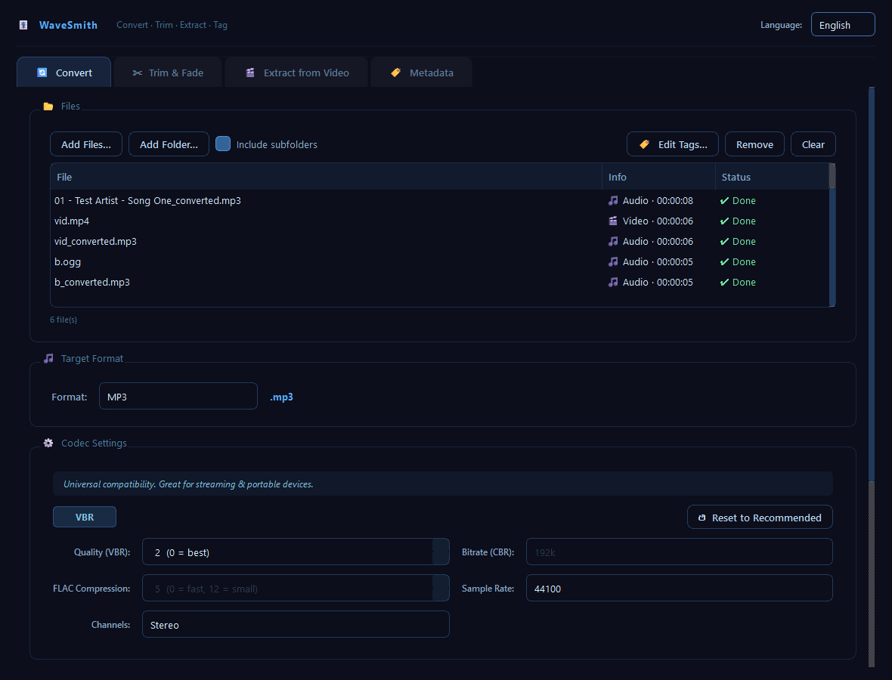
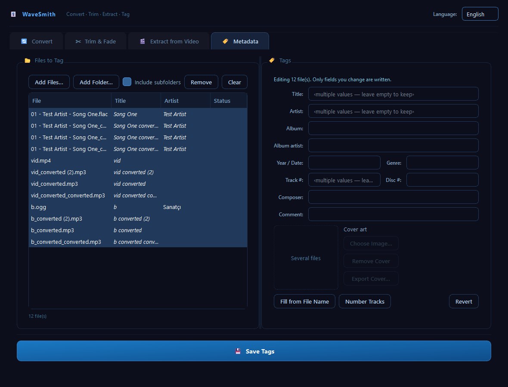

# WaveSmith

**WaveSmith** is a desktop audio tool for Windows: convert, trim, extract audio from video and edit tags — one file or a whole folder at a time. It is a friendly front-end for [FFmpeg](https://ffmpeg.org/), with an English and Turkish interface.



## Features

- **Drag & drop** — drop files *or folders* anywhere on the window. Folders are scanned for media files (optionally including subfolders).
- **Batch conversion** — convert any number of files to MP3, AAC (M4A), OGG Vorbis, Opus, FLAC, WAV, AIFF, WMA, AC3 (Dolby), DTS or MP2, with per-file progress, cancel and "retry failed".
- **Codec settings** — VBR quality, CBR bitrate, FLAC compression, sample rate and channels (including 5.1 for AC3/DTS), with recommended defaults per format.
- **Trim & fade** — built-in player with a visual trim bar; set start/end points while listening, add fade-in/fade-out with an adjustable length.
- **Extract audio from video** — copy the audio stream losslessly ("native" mode, no re-encoding) or re-encode it to any supported format. Works in batch too.
- **Metadata (tag) editor** — edit title, artist, album, album artist, year, genre, track, disc, composer and comment for one or many files at once; add, replace, remove or export **cover art** (MP3, FLAC, M4A/MP4). Helpers: *Fill from file name* (`01 - Artist - Title`) and *Number tracks*. Tags are rewritten without re-encoding the audio.
- **Tags on conversion** — source tags and cover art are carried over to the converted files, and you can override tags for the output before converting.
- **English / Türkçe** — the language follows your system on first start and can be switched from the top-right menu at any time.
- **Portable** — no installer, no registry entries. Settings are stored in `WaveSmith.ini` next to the program.



## Download (Windows)

Get `WaveSmith-<version>-win64-portable.zip` from the [Releases](../../releases) page, unzip it anywhere (desktop, USB stick…) and run `WaveSmith.exe`. FFmpeg is included in the zip.

> Windows SmartScreen may warn about an unsigned app the first time. Choose **More info → Run anyway**.

## Run from source

Requires Python 3.10+ and FFmpeg.

```bash
git clone https://github.com/borasavkar/WaveSmith.git
cd WaveSmith
python -m venv .venv
.venv\Scripts\activate
pip install -r requirements.txt
python run.py
```

WaveSmith looks for `ffmpeg.exe` / `ffprobe.exe` next to the program first, then on your `PATH`. Easiest options:

- put `ffmpeg.exe` and `ffprobe.exe` in the project folder (e.g. from [gyan.dev](https://www.gyan.dev/ffmpeg/builds/)), or
- install FFmpeg system-wide, e.g. `scoop install ffmpeg` or `winget install Gyan.FFmpeg`.

You can also pass files or folders on the command line (`python run.py "D:\Music\Album"`); they are added to the Convert tab.

## Build the portable package

```bash
pip install -r requirements.txt
python build.py
```

This creates `dist/WaveSmith/` (ready to run) and `dist/WaveSmith-<version>-win64-portable.zip`. `ffmpeg.exe` and `ffprobe.exe` must be in the project folder or on `PATH`; they are copied next to `WaveSmith.exe`.

## Project layout

```
run.py                 entry point
core/ffmpeg_engine.py  FFmpeg/FFprobe wrapper: conversion, trim, extraction, tags, cover art
core/i18n.py           English/Turkish strings
core/settings.py       portable INI settings
ui/main_window.py      main window and the four tabs
ui/widgets.py          file queue, pickers, codec panel, trim bar, tag form
build.py, WaveSmith.spec  PyInstaller build
```

## Adding a language

All UI text lives in `core/i18n.py`. Add the language code to `LANGUAGES` and a translation to each entry in `STRINGS`; missing entries fall back to English.

## License

WaveSmith is released under the [MIT License](LICENSE).
The portable package bundles FFmpeg, which has its own license — see [THIRD-PARTY-NOTICES.md](THIRD-PARTY-NOTICES.md).
